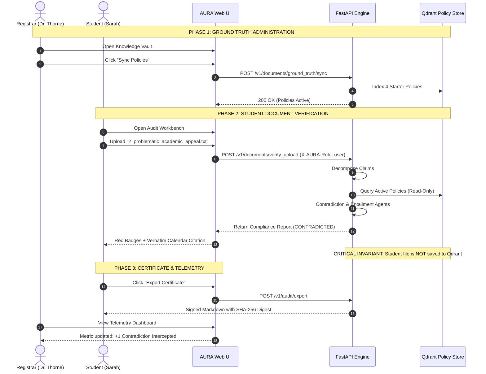

# AURA — Academic Document Verification Demo Guide & UI Test Case Walkthrough

This document provides a comprehensive, repeatable guide for presenting and evaluating the **AURA (Agentic Unified Reliability Auditor)** academic demonstration. It covers the **real-world higher education problem**, the **underlying architecture**, and **step-by-step test cases executed entirely through the Web UI**.

---

## 1. Real-Life Problem & Context

### The Challenge in Higher Education
Every semester, university registrars, department chairs, and academic advisors process thousands of high-stakes student documents:
- Course add/drop petitions
- Late withdrawal appeals
- Prerequisite waiver and sequence evaluations
- Degree audit & graduation petitions
- Satisfactory Academic Progress (SAP) and scholarship retention appeals

**The Human Cost:** An advisor manually cross-referencing a student's petition against a 140-page Course Catalog, a 12-page Academic Calendar, and a complex Prerequisite Tree takes **20–30 minutes per student**. Human fatigue leads to missed deadlines and incorrect approvals.

**The Generative AI Risk:** When universities attempt to use standard LLMs (ChatGPT, general copilots) to automate advisory answers, the models frequently **hallucinate**:
- They invent non-existent course prerequisites.
- They cite outdated add/drop deadlines.
- They fabricate policies that do not exist, leading to tuition loss, delayed graduations, or student grievances.

### The AURA Solution
AURA is an **Agentic Compliance Auditor** that strictly separates **authoritative university ground truth** from **unverified student submissions**:
1. **Zero Hallucination:** Claims are evaluated exclusively against indexed university ground truth. If evidence is missing, AURA returns an explicit `INSUFFICIENT_EVIDENCE` verdict rather than guessing.
2. **Deterministic Verification:** Multi-agent pipeline (Planner $\to$ Hybrid Retriever $\to$ Fact Agent $\to$ Logic/Contradiction Agent $\to$ Evaluator).
3. **Ground-Truth Data Isolation:** A student petition is **never** indexed into the policy store. It can never contaminate future institutional retrieval.

---

## 2. System Access & Environment Setup

All services run cleanly inside Docker Compose:

| Component | URL / Port | Role / Purpose |
|---|---|---|
| **AURA Web UI** | [http://localhost:3006](http://localhost:3006) | Student & Officer Web Interface |
| **AURA Backend API** | [http://localhost:8000](http://localhost:8000) (Swagger: `/docs`) | FastAPI Agentic Execution Engine |
| **Qdrant Vector DB** | [http://localhost:6333/dashboard](http://localhost:6333/dashboard) | Canonical Policy Vector Collections |
| **PostgreSQL Database** | Port `5433` (External) / `5432` (Docker) | Audit Traces & Cryptographic Signatures |
| **Redis Cache** | Port `6380` (External) / `6379` (Docker) | Pipeline State & Execution Lock Store |
| **pgAdmin 4** | [http://localhost:5050](http://localhost:5050) | Database Audit Inspection (`admin@example.com` / `admin`) |

---

## 3. Demo Roles & Personas

Switch between these personas using the top navigation banner or the login screen:

```
┌────────────────────────────────────────────────────────┐
│  DEMO PERSONA 1: Dr. Aris Thorne                       │
│  Role: Academic Officer / University Registrar         │
│  Capabilities: Upload, sync, list & deactivate         │
│                official campus policies.               │
└────────────────────────────────────────────────────────┘

┌────────────────────────────────────────────────────────┐
│  DEMO PERSONA 2: Sarah Jenkins                         │
│  Role: Student / Advisor (Undergraduate CS)            │
│  Capabilities: Audit documents, paste text, inspect   │
│                evidence, and export audit certificates.│
└────────────────────────────────────────────────────────┘
```

---

## 4. End-to-End Workflow Diagram



---

## 5. Step-by-Step UI Test Cases

### Test Case 1: Ground-Truth Policy Administration (Officer)

* **Goal:** Verify that an administrator can view, sync, and manage official university policies.
* **Persona:** `Dr. Aris Thorne (Registrar)`

#### Steps:
1. Navigate to **[http://localhost:3006](http://localhost:3006)**.
2. In the top banner or login screen, select **Dr. Aris Thorne (Officer / Registrar)**.
3. In the left navigation, click **Campus Knowledge Vault**.
4. You will see the Canonical Document Inventory displaying the 4 pre-seeded university policies:
   - `2025-2026 Academic Calendar & Add/Drop Regulations`
   - `Undergraduate Course Catalog & Prerequisite Graph`
   - `Student Code of Academic Integrity & AI Policy`
   - `Title IV Federal Financial Aid & SAP Satisfactory Progress Policy`
5. Click the **"Sync Policies"** button at the top right of the inventory table.
   - *Expected Outcome:* Toast notification: `"Reconciled Ground Truth: 4 policies indexed, 0 unchanged."`
6. Click the file upload dropzone under **"Ingest Official Campus Policy"**, and select an addendum file (e.g., `CS_Honors_Policy_Addendum_2026.txt`).
   - *Expected Outcome:* The file is chunked, embedded via FastEmbed, stored in Qdrant, and immediately appears in the inventory table marked with `Tier 1 (Canonical)` and status `Indexed`.
7. Click the **Trash / Deactivate** icon next to any document.
   - *Expected Outcome:* The policy is immediately purged from active retrieval, ensuring outdated policies never support future audits.

---

### Test Case 2: 100% Compliant Student Petition (Student)

* **Goal:** Verify that a valid student petition matching official policies produces a verified, fully supported compliance report with real citations.
* **Persona:** `Sarah Jenkins (Student)`

#### Real-Life Scenario:
Sarah wants to drop CS 101 on September 12, 2025 (within the penalty-free add/drop window) and enroll in CS 201 the following semester.

#### Steps:
1. Switch user to **Sarah Jenkins (Student)**.
2. Click **Advisory & Policy Audit Workbench** in the navigation bar.
3. Under **Input Source**, click the **Upload Document** tab.
4. Upload `aura-system/backend/data/sample_student_docs/1_valid_student_petition.txt`:
   ```text
   Academic Petition for Course Add/Drop and Sequence Planning
   Student: Sarah Jenkins (ID: CS-2025-8841)
   Term: Fall 2025

   I am currently enrolled in CS 101 for the Fall 2025 semester.
   According to university policy, the official deadline to add or drop a course without a 'W' grade for Fall 2025 is Friday, September 12, 2025.
   I intend to complete the prerequisite requirement of CS 101 before enrolling in CS 201 next semester.
   ```
5. Click **"Run Audit"**.
6. **Expected Outcome:**
   - **Overall Reliability Score:** `95% - 100% (Reliable)`
   - **Claim 1 Outcome:** `SUPPORTED`
     - **Citations:** Cites `2025_2026_Academic_Calendar.md §1`: *"Add/Drop Deadline Without Penalty: Friday, September 12, 2025 at 5:00 PM EST."*
   - **Claim 2 Outcome:** `SUPPORTED`
     - **Citations:** Cites `Computer_Science_Course_Catalog.md`: *"CS 101 is prerequisite for CS 201."*
   - **Integrity Guarantee:** Notice banner confirms: *"Strictly verified without ground-truth contamination. File was not stored as policy."*

---

### Test Case 3: Problematic Appeal with Policy Contradictions (Student)

* **Goal:** Verify that AURA detects numeric and logical conflicts, flags them with clear red indicators, and cites the conflicting policy rule.
* **Persona:** `Sarah Jenkins (Student)`

#### Real-Life Scenario:
A student petitions to drop a course on **November 15 without a 'W' grade**, and claims that their **2.80 GPA** is sufficient to retain their Presidential Merit Scholarship.

#### Steps:
1. In the **Audit Workbench**, click **Upload Document**.
2. Upload `aura-system/backend/data/sample_student_docs/2_problematic_academic_appeal.txt`:
   ```text
   Academic Standing Appeal and Late Drop Request
   Student: Marcus Vance (ID: EN-2024-5102)
   Term: Fall 2025

   I formally request permission to drop CS 301 on November 15, 2025 without receiving a 'W' grade on my official transcript.
   Additionally, I confirm that my current cumulative GPA of 2.80 is sufficient to maintain my Presidential Merit Scholarship for the upcoming academic year.
   ```
3. Click **"Run Audit"**.
4. **Expected Outcome:**
   - **Overall Reliability Score:** `Low / Flagged (Unreliable)`
   - **Claim 1 Outcome:** `CONTRADICTED`
     - **Conflict Identified:** Add/drop deadline without penalty was **September 12, 2025**. The final withdrawal deadline ('W' grade) was **October 31, 2025**. November 15 is after both deadlines and results in an automatic grade of 'F'.
     - **Citation:** `2025-2026 Academic Calendar §1`.
   - **Claim 2 Outcome:** `CONTRADICTED`
     - **Conflict Identified:** Presidential Merit Scholarship requires a **minimum cumulative GPA of 3.25**. Marcus's 2.80 GPA fails this policy requirement.
     - **Citation:** `Financial_Aid_and_Scholarships.md §1`.
   - **Self-Repair Suggestion:** Displays recommended replacement text reflecting actual university regulations.

---

### Test Case 4: Ambiguous / Inconclusive Request (Honest Abstention)

* **Goal:** Demonstrate that when a student asks about something **not covered by university policy**, AURA admits the evidence gap instead of hallucinating an answer.
* **Persona:** `Sarah Jenkins (Student)`

#### Real-Life Scenario:
A student requests that an external experiential portfolio on Quantum Computing be accepted for elective credit without departmental review.

#### Steps:
1. In the **Audit Workbench**, upload `aura-system/backend/data/sample_student_docs/3_ambiguous_transfer_petition.txt`:
   ```text
   Departmental Independent Study Recognition Petition
   Student: Elena Rostova (ID: TR-2025-9011)

   I am requesting permission to submit an experiential research portfolio on Quantum Computing Architectures.
   I request that the academic department evaluate this portfolio to satisfy elective degree requirements.
   ```
2. Click **"Run Audit"**.
3. **Expected Outcome:**
   - **Claim Verdict:** `INSUFFICIENT_EVIDENCE` (Amber Badge)
   - **Audit Rationale:** *"Insufficient evidence: No matching active university policy found in Ground Truth knowledge vault."*
   - **Registrar Advisory Notice:** *"Academic Registrar Notice: Requires direct verification against Student Handbook/Academic Calendar."*
   - **No Hallucination:** AURA does not invent a fictional policy or passage to force a pass.

---

### Test Case 5: Exporting Cryptographic Compliance Certificates

* **Goal:** Verify that every completed audit produces a tamper-evident audit certificate.
* **Persona:** `Sarah Jenkins` or `Dr. Aris Thorne`

#### Steps:
1. In the **Audit Workbench**, after running any audit (e.g., Test Case 2 or 3), look at the right-hand panel.
2. In the **Audit Lineage & Cryptographic Proof** section, click **"Export Certificate"** (or choose Markdown / JSON).
3. Open the downloaded `.md` file.
4. **Expected Content:**
   - **Execution Trace ID:** Unique trace (e.g. `trace_audit_8ccbb6bf6616`).
   - **Cryptographic Fingerprint:** SHA-256 hash digest of the exact claims and verdicts.
   - **Evidence Citations:** List of canonical sources, chunk IDs, and trust tiers.
   - **Evaluator Decision:** Deterministic bucket (`Reliable` / `Unreliable`).

---

### Test Case 6: Real-Time Telemetry & Observability Dashboard

* **Goal:** Confirm that dashboard metrics accurately reflect real student audits without manual database edits.
* **Persona:** `Dr. Aris Thorne (Registrar)`

#### Steps:
1. Switch persona to **Dr. Aris Thorne**.
2. In the navigation bar, click **Campus Compliance Telemetry** (or Minimal Dashboard).
3. Inspect the live metric cards:
   - **Total Campus Audits:** Incremented by the exact number of audits run in Test Cases 2, 3, and 4.
   - **Flagged Contradictions:** Shows the intercepted contradictions from Test Case 3.
   - **Active Policies:** Reflects the live count from the Qdrant Knowledge Vault.
4. Inspect the **Recent Institutional Audits Table**:
   - The student petition audits appear at the top of the table with their exact Trace IDs, timestamps, and compliance percentages.

---

### Test Case 7: Security Guardrail Verification (Role Enforcement)

* **Goal:** Verify that student accounts cannot delete or upload authoritative university policies.
* **Persona:** `Sarah Jenkins (Student)`

#### Steps:
1. Switch to **Sarah Jenkins (Student)**.
2. Notice that the **Campus Knowledge Vault** and **Agent Pipeline Config** tabs are hidden from the sidebar.
3. If an unauthorized client attempts to send an officer request:
   ```bash
   curl -X POST http://localhost:8000/v1/documents/ground_truth/sync \
     -H "X-AURA-Role: user"
   ```
4. **Expected Outcome:**
   - HTTP Status: **`403 Forbidden`**
   - Error Response: `"detail": "Operation requires capability: manage_knowledge_base"`

---

## 6. Automated Verification

To run the complete automated test suite from your terminal:

```bash
cd aura-system/backend

# 1. Run the End-to-End Academic Acceptance Test (All 9 phases)
./venv/bin/pytest tests/test_academic_e2e_demo.py -v

# 2. Run the Full Backend Test Suite (All 74 Tests across 10 modules)
./venv/bin/pytest tests/ -v
```

*Expected Terminal Result:*
```
=================== 74 passed in 86s ===================
```
